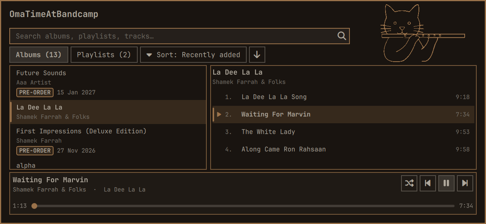
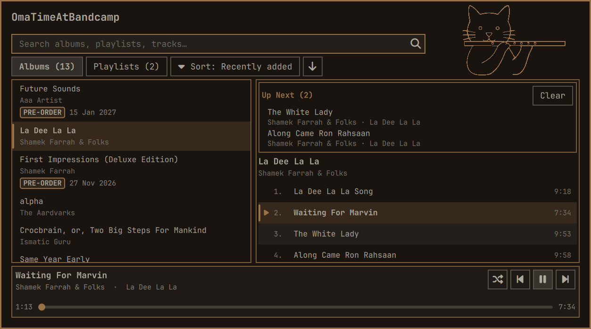

# OmaTimeAtBandcamp

## What it is

Your Bandcamp collection, in an Omarchy bar panel.

OmaTimeAtBandcamp puts the music you actually own into your desktop bar. It
reads your Bandcamp collection and playlists, then streams them through
Bandcamp's official Subsonic API. The library is your **real collection** —
including purchases whose album pages Bandcamp no longer lists, and pre-orders
(shown with their release date; their unreleased tracks stay greyed out until
release day).

- Panel built for the Omarchy shell (Quickshell): albums, playlists, search,
  queue, keyboard navigation, MPRIS media keys through the plugin's own bridge
  (not mpv-mpris).
- Playback through mpv; no browser tab, no downloads, no separate music app.
- Session import from the browser you already use, or a manual cookie file.
- Your data stays local; the only network destinations are Bandcamp hosts.

> **Beta.** v1.0.0-beta.1 is a feature-complete public beta looking for
> environment testing — different resolutions, display scaling, themes and
> library sizes. See the [release notes](docs/release-notes-v1.0.0-beta.1.md)
> and [file an issue](https://github.com/gy9cd2bvr7-svg/omatimeatbandcamp/issues)
> if something does not fit.

## Install

Requires Omarchy with shell plugins enabled, plus `mpv` and Python 3.11+
(`python3`, `cryptography`, `secretstorage`; all standard on a current Omarchy
install). If Python reports a missing module:

```bash
omarchy pkg add python-cryptography python-secretstorage
```

Install straight from this repository's GitHub URL:

```bash
omarchy plugin add https://github.com/gy9cd2bvr7-svg/omatimeatbandcamp.git --enable
```

The command clones the plugin into
`~/.config/omarchy/plugins/com.github.dtotheatothevtothee.omatimeatbandcamp`,
validates its manifest, rescans the shell and asks where to put the bar widget.
Choose **Right** (the plugin's default), or any other bar section you prefer.

If you added it without `--enable`, enable it later with:

```bash
omarchy plugin enable com.github.dtotheatothevtothee.omatimeatbandcamp --section right
```

The bar shows a plain **BC** item. Left-click it to open the panel. To update
later: `omarchy plugin update com.github.dtotheatothevtothee.omatimeatbandcamp`.
To remove it: `omarchy plugin remove com.github.dtotheatothevtothee.omatimeatbandcamp`.

## Setup

Two things are needed once: a Bandcamp **session cookie** (so the plugin can see
your collection) and a Bandcamp **Subsonic pair** (so it can stream). Neither is
an account password, and neither is entered into a chat or a command line.

### 1. Import your Bandcamp browser session

Sign in to [bandcamp.com](https://bandcamp.com) in a browser on the same machine.
With the default settings the plugin imports the Bandcamp cookies from that
browser before every library sync and writes a private Netscape cookie jar to
`~/.cache/omatimeatbandcamp/cookies.txt` (directory `0700`, file `0600`).

**Chromium family — automatic.** Chrome, Chromium, Brave, Edge and Vivaldi are
read directly. Their cookie encryption key comes from the desktop keyring
(GNOME Keyring / KWallet via Secret Service); the importer decrypts only
`bandcamp.com` cookies and copies the cookie database into the private cache
directory before reading it. Pick a specific browser with the `browser` setting
(`chrome`, `chromium`, `brave`, `edge`, `vivaldi`) or leave it on `auto`.

**Firefox — automatic.** Firefox profiles are read from
`~/.mozilla/firefox`, the Flatpak location and the Snap location. Firefox stores
these cookies unencrypted, so this path also works when no keyring is available.
Pick it explicitly with `browser = "firefox"` if `auto` chooses another browser.

**Anything else — manual `cookies.txt`.** Export the Bandcamp cookies from your
browser in **Netscape cookies.txt** format (many cookie-editor extensions can do
this), save the file somewhere private, and set the plugin's `cookiePath` to that
file. When `cookiePath` is set, automatic import is skipped and that file is used
as-is. Keep it readable only by you:

```bash
chmod 600 /path/to/cookies.txt
```

The file must contain at least the `identity` cookie for `bandcamp.com`.
`cookiePath` is also the escape hatch for any browser the importer does not
recognise.

**If automatic import fails or the keyring is locked.** Chromium-family
import needs an unlocked Secret Service. After a fresh login, an SSH session, a
headless start, or a locked keyring, the key is unavailable and no cookies are
found. Unlock the keyring (log in to the desktop normally, or open the keyring
application and unlock the login collection), then refresh the library. If you
cannot unlock it, use the manual `cookies.txt` route above.

Leaving `userUrl` empty makes the plugin detect your account from the imported
session (`https://bandcamp.com/settings`). To browse a different profile, set
`userUrl` to that profile's collection URL explicitly.

### 2. Create the Subsonic pair and save it locally

Bandcamp's Subsonic API is what actually streams the audio. On
[bandcamp.com](https://bandcamp.com), open **Fan Settings → Subsonic** and
generate the username/password pair for a Subsonic client. Bandcamp shows the
pair on that page; copy it into the local file below.

- It is a **dedicated app-style pair**, not your Bandcamp account password.
- It is **revocable** from the same Fan Settings → Subsonic page. Revoking it
  cuts off the plugin (and any other Subsonic client using it); your Bandcamp
  account and password are unaffected.
- Treat it like a password. Do not paste it into chat, an issue, a screenshot or
  a shell command that gets logged.

The plugin reads it from `~/.config/omatimeatbandcamp/credentials.toml`
(directory `0700`, file `0600`; the backend tightens and verifies those
permissions, and refuses a group/world-readable file). Create it once in a text
editor:

```toml
user = "your-subsonic-username"
pass = "your-subsonic-password"
```

Then lock it down:

```bash
mkdir -p ~/.config/omatimeatbandcamp
chmod 700 ~/.config/omatimeatbandcamp
chmod 600 ~/.config/omatimeatbandcamp/credentials.toml
```

Open the panel and press the kitty logo → **Refresh**. The first sync can take a
while on a large collection; later syncs are incremental and keep the cached
library on screen. The status line above the panes shows progress.

## Security notes

- **Credentials never go to a third party.** The only services the plugin calls
  are Bandcamp's own endpoints (`bandcamp.com` / `*.bandcamp.com`): the
  collection feed, album pages, the Subsonic API and cover art. Audio may be
  delivered by Bandcamp's CDN after a redirect, but the session cookie is not
  attached to that request. There is no analytics, telemetry or external service.
- **Cookies only go to Bandcamp, over HTTPS.** The backend attaches the imported
  cookie header only when the destination is `https://bandcamp.com` or an
  `https://*.bandcamp.com` host. A non-Bandcamp URL never receives it. Subsonic
  playback is loaded by the backend without a cookie header.
- **The Subsonic pair is used only to sign Bandcamp Subsonic requests.** It is
  sent to Bandcamp's own Subsonic endpoint (as the API requires) and nowhere
  else. Auth uses a fresh random salt per session; the values are never printed
  in normal output or written into the library cache.
- **MPRIS is the plugin's own bridge, not mpv-mpris.** `backend/mpris.py`
  publishes only playback state and the current track's title and artist (plus
  the local cover file). It does not use mpv-mpris, and stream URLs never appear
  on the D-Bus bus.
- **What lives where:**
  - `~/.config/omatimeatbandcamp/credentials.toml` — Subsonic user/password
    (`0600`; directory `0700`). Required for streaming.
  - `~/.cache/omatimeatbandcamp/cookies.txt` — imported Bandcamp session cookie
    jar (`0600`; directory `0700`). Recreated from the browser on refresh.
  - `~/.cache/omatimeatbandcamp/library/library.json` — collection/playlist
    metadata (titles, artists, ids, release dates, streamability). No
    credentials or cookie values.
  - `~/.local/state/omatimeatbandcamp/ui.json` and `queue.json` — sort/filter
    choices and the pending Up Next list (`0600`).
  - `~/.cache/omatimeatbandcamp/current-art.jpg` — current cover, downscaled for
    MPRIS.
- **Log out** in the settings menu deletes the imported cookie jar (the next
  refresh imports it again); it does not touch your browser or Bandcamp account.
  Revoke the Subsonic pair on Bandcamp's site when you want to cut off streaming.

The plugin never reads or prints cookie/credential values into its UI. It does
not ship or commit any cookie jar, credentials file or real library cache
(`.gitignore` covers them).

## Usage

### Panel keys

These work only while the panel is open and focused. The plugin registers **no
global shortcuts** itself.

- **Search:** `/` focuses the search field. Typing while a list is focused also
  returns to search and keeps the character. `Esc` clears the query, then closes
  the panel. `↓` / `↑` from the search field enter the focused list.
- **Move and play:** `↓` / `↑` move inside the focused list; `Enter` plays the
  selected album, playlist, search result or track. `←` / `→` switch between the
  album/playlist list and the track list. `Space` toggles play/pause when a list
  is focused.
- **Queue:** right-click a track row (or focus it and press `Menu` / `Shift+F10`)
  for **Play Next** (`Alt+Enter`, front of the queue) or **Add to Queue**
  (`Ctrl+Enter`, end). On an album or playlist row, `Ctrl+Enter` appends its
  streamable tracks. A non-empty queue appears as **Up Next (n)** above the
  current contents. With a queue row focused, `Enter` plays it now and `Delete`
  removes it; the **Clear** button empties the queue. Up Next survives a shell
  restart and is cleared when you start a new context.
- **Shortcuts view:** open the settings menu with the kitty logo and choose
  **Keyboard shortcuts**. It replaces the two panes with a two-column reference
  of every built-in key. `Esc` closes it and returns to the panel.
- **Full focus order:** `Tab` / `Shift+Tab` walk search → clear/magnifier →
  settings (kitty logo) → Albums → Playlists → Sort → sort direction → list →
  Up Next and Clear → tracks → Shuffle → Previous → Play/Pause → Next. Every
  focused control shows the theme accent.
- **Menus:** `Menu` or `Shift+F10` opens the focused row's context menu; arrows
  navigate, `Enter` activates, `Esc` closes without acting. `Esc` backs out one
  layer at a time (confirmation, menu, shortcuts view, search, panel).

### Optional global binds — not shipped

The plugin deliberately ships **no** Hyprland keybindings. If you want global
transport keys, add these two lines to your personal Hyprland bindings file —
`~/.config/hypr/bindings.lua` on current Omarchy:

```lua
o.bind("SUPER + ALT + B", "OmaTimeAtBandcamp panel",
       "omarchy-shell omatimeatbandcamp toggle")
o.bind("SUPER + ALT + P", "OmaTimeAtBandcamp play/pause",
       "omarchy-shell omatimeatbandcamp playPause")
```

These are **optional user bindings, not part of the plugin**. They take effect
when the file is saved (or after `hyprctl reload`) and work with the panel
closed, from any app. Check that the combos are free on your machine first
(`SUPER + K` opens Omarchy's keybindings list). The plugin never unbinds or
overwrites anything.

## Screenshots

Fresh full-panel captures of the current build, through the live theme/font lane
at the real panel size. The screenshots use the synthetic test-fixture library,
not a real account.





A syncing-state capture is also kept at
[`docs/images/panel-syncing.png`](docs/images/panel-syncing.png).

## Configuration

Settings live in the plugin's entry in `~/.config/omarchy/shell.json` and are
editable from the standard Omarchy plugin settings form.

| Setting | Default | What it does |
| --- | --- | --- |
| `userUrl` | empty | Bandcamp collection URL. Empty auto-detects the account from the imported session; set it to browse another profile. |
| `cookiePath` | empty | Netscape `cookies.txt` to use instead of automatic browser import. Empty imports from the browser on every sync. |
| `browser` | `auto` | Browser to import from: `auto`, `chrome`, `chromium`, `brave`, `edge`, `vivaldi`, `firefox`. |
| `includePlaylists` | `true` | Show Bandcamp playlists alongside albums. |
| `refreshIntervalMin` | `15` | Background library refresh interval, 5–240 minutes. |
| `mpvFlags` | empty | Extra flags passed to mpv (video is always disabled). |
| `autoPlayOnSelect` | `false` | Reserved; currently no effect. |

The settings menu (kitty logo) holds **Refresh**, **Hide pre-orders**
(remembered), **Keyboard shortcuts**, **Collection** (opens your collection page
with `xdg-open`) and **Log out** (with confirmation).

## What you get

- Albums and playlists from your real Bandcamp collection, including purchases
  missing from the public web listing; the library merges the web collection
  with Bandcamp's Subsonic server.
- Pre-orders with a **PRE-ORDER** pill and release date, “N of M tracks
  available”, and unreleased tracks greyed out and non-playable. Partially
  released pre-orders play only what Bandcamp has released.
- Global search across albums, playlists and tracks; two-line wrapping rows;
  selected and playing states in the theme accent.
- Sort by Recently added, Artist A–Z, Title A–Z or Release date, with a
  remembered direction per tab; optional Hide pre-orders filter.
- Shuffle per context (whole library, album, playlist, search), remembered.
- Footer transport with a seekable progress bar and elapsed/total time; a
  visible notice and automatic skip if a stream fails.
- Session-persistent Up Next queue with Play Next / Add to Queue, Clear and
  Remove.
- MPRIS (`org.mpris.MediaPlayer2.omatimeatbandcamp`), so laptop media keys and
  Omarchy's media bindings control playback. The plugin ships its own MPRIS
  bridge: it publishes only playback state and the current track's title and
  artist (plus the local cover file). It does **not** use mpv-mpris, and stream
  URLs never appear on the bus.

## Data and files

- Library cache: `~/.cache/omatimeatbandcamp/library/library.json`, written by
  `python3 backend sync` (web collection feed + Subsonic album/playlist calls).
- Subsonic credentials: `~/.config/omatimeatbandcamp/credentials.toml`.
- Browser session: imported by `cookies.py` into
  `~/.cache/omatimeatbandcamp/cookies.txt`; `cookiePath` overrides it.
- Cover art: `~/.cache/omatimeatbandcamp/current-art.jpg` (local copy for MPRIS;
  source is Subsonic `getCoverArt`).
- UI state: `~/.local/state/omatimeatbandcamp/ui.json`; queue:
  `~/.local/state/omatimeatbandcamp/queue.json`.

The v1 page scraper (`fetch.py`) has been removed; `backend/` is the data and
playback layer now.

## Troubleshooting

- **“Not signed in to Bandcamp” / empty library:** sign in to Bandcamp in the
  browser you configured, unlock the keyring if needed, then Refresh. With
  `cookiePath`, check that the file is still a valid Netscape cookie file and
  contains `identity`.
- **Library loads but tracks will not play:** check
  `~/.config/omatimeatbandcamp/credentials.toml` exists, has `user` and `pass`,
  and is `0600`. Generate a fresh pair on Bandcamp if you revoked the old one.
- **Black/blank panel after an update:** `omarchy-shell shell rescanPlugins`,
  then reopen the panel. Run `omarchy plugin validate` on the plugin folder if
  it still fails.
- **Wrong bar section:** `omarchy bar move com.github.dtotheatothevtothee.omatimeatbandcamp --section right`
  (or open the bar settings).

## IPC

All commands go through the Omarchy shell:

```bash
omarchy-shell omatimeatbandcamp status
omarchy-shell omatimeatbandcamp toggle
omarchy-shell omatimeatbandcamp playPause|resume|pause|next|previous|stop|refresh
omarchy-shell omatimeatbandcamp restartPlayer
omarchy-shell omatimeatbandcamp seek <seconds>
omarchy-shell omatimeatbandcamp play <itemId>
omarchy-shell omatimeatbandcamp clearCookies
```

## Development

- Offline Python tests: `python3 -m unittest discover -s tests -t .`
- Live fixture tests: `OMATIME_LIVE=1 python3 -m unittest tests.test_live_fixtures`
- QML interaction tests (offscreen + live-theme lane): `tests/qml/run.sh`
- Validate the plugin folder: `omarchy plugin validate .`

`backend/subsonic.py` is the Subsonic client, `backend/library.py` the cache and
sync, `backend/mpris.py` the plugin's own MPRIS bridge (not mpv-mpris),
`mpvctl.py` the player process and
`cookies.py` the browser-session importer. Measurements and API findings live in
`spike/SUBSONIC-REPORT.md`; the versioned design history is in
`docs/omatimeatbandcamp-v3-spec.md`.

## Notes

- Stream URLs are time-limited; the library refreshes on an interval.
- This is for personal use. Respect Bandcamp's terms of service and the artists
  you listen to — buying the music is the point.
- License: MIT (see `manifest.json`).
